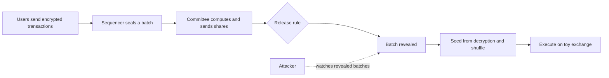

# Veilpipe

> Simulating threshold-encrypted mempools inside Layer 2 block times


## Contents

- [Overview](#overview)
- [The problem](#the-problem)
- [What the simulation does](#what-the-simulation-does)
- [How it works](#how-it-works)
- [Designs compared](#designs-compared)
- [Contributions](#contributions)
- [Attacks modelled](#attacks-modelled)
- [Project structure](#project-structure)
- [Getting started](#getting-started)
- [Configuration](#configuration)
- [Experiments](#experiments)
- [Assumptions and limitations](#assumptions-and-limitations)
- [Results](#results)
- [References](#references)
- [Team](#team)

## Overview

Veilpipe is a Python simulator built for our Cryptography course project at BITS Pilani Dubai Campus. It models a Layer 2 blockchain that uses an **encrypted mempool** and asks one practical question: **can a decryption committee finish its work inside an L2 block time, and what does it cost in safety and delay when we speed it up?**

It is a simulation. It does not run real cryptography. Decryption times are taken from the published papers listed below.

## The problem

- On most blockchains, pending transactions sit in a public mempool. Bots and block builders can read them and reorder or insert their own transactions (front-running, back-running, sandwich attacks). The profit they make is called **MEV** (Maximal Extractable Value).
- An **encrypted mempool** hides transactions until their position is fixed. A committee of `n` members shares the decryption key, and any `t` of them can decrypt a batch together.
- The catch is time. Decryption takes computation and network round trips, while Layer 2 blocks are short. In our experiments we test block times from 250 ms to 2 s.
- None of the papers in our survey compare their decryption times against L2 block intervals, and a naive speed-up (pipelining) creates a new MEV risk.

**Our questions:**
1. For a given block time, which committee size, threshold and batch size still fit?
2. How much does pipelining help, and what does it cost in user delay and attack exposure?
3. Can we order transactions fairly without extra rounds or trusted hardware?

## What the simulation does

Veilpipe models a pretend L2 and runs it for a few minutes of simulated time, many times, with different settings.

- **Users** send transactions at random times (Poisson arrivals).
- **The sequencer** collects them and seals a batch every block interval.
- **The committee** (N members, split into S subsets) decrypts each batch. Each member's share time grows with the batch size, shares travel with a random network delay, and the batch is revealed once `t` shares arrive and are combined. Some members can be slow or withhold their share.
- **A release rule** decides when a batch may be revealed: immediately, or only after one or two later batches are sealed.
- **Ordering:** after reveal, the batch is shuffled using a seed derived from the decryption output.
- **A toy exchange** (constant product, `x * y = k`) executes the ordered batch so profits and losses can be measured.
- **An attacker** (the sequencer) tries to back-run revealed batches and to wrap whole batches blindly.
- **Metrics:** throughput, end-to-end delay per user (mean, median, 95th and 99th percentile), whether the system stays stable, attack success and profit, and decryption failure rate.

## How it works




## Designs compared

| Design | Idea | Weakness |
|---|---|---|
| **Sequential** | Collect a batch, decrypt it, then start the next one | Slow: one block per collection plus decryption time |
| **Naive pipelining** | Decrypt batch N while batch N+1 is collected, reveal immediately | Fast, but the sequencer sees N while later batches are still open |
| **Veilpipe** | Pipelining plus a release rule, a shuffle seeded by the decryption itself, and committee subsets for load and liveness | Extra delay for users, and back-running is reduced but not removed |

## Contributions

1. **Permutation seed from the threshold decryption.** The shuffle seed is a hash of the combined decryption output and the batch ID. This needs no extra beacon round and no trusted hardware, and we compare it with both options.
2. **Safe operating region.** A chart showing, for each block time, which combinations of committee size, threshold and batch size still decrypt in time.

## Attacks modelled

| Attack | What the attacker does | What it tests |
|---|---|---|
| **A: Back-run** | Reads a revealed batch and puts a trade into the next batch that is still open, to profit from the price move | The release rule and the shuffle |
| **B: Blind wrap** | Puts one trade first and one last in every batch it builds, guessing the direction | The shuffle, and metadata leaks |

## Project structure

```
Veilpipe/
├── README.md
├── INTERFACES.md          function contracts between modules
├── requirements.txt
├── pytest.ini
├── veilpipe/
│   ├── config.py          all settings in one place
│   ├── timing.py          decryption times from the papers, network delay
│   ├── events.py          event queue and clock
│   ├── entities.py        Tx, Batch and related objects
│   ├── committee.py       shares, release rule, failures
│   ├── sequencer.py       arrivals, batching, sealing
│   ├── pipeline.py        wires everything together
│   ├── exchange.py        toy exchange
│   ├── attacker.py        back-run and blind wrap attacks
│   ├── ordering.py        seed and shuffle
│   ├── metrics.py         summaries and confidence intervals
│   ├── analytic.py        closed-form checks for the simulator
│   └── rotation_math.py   collusion probabilities
├── experiments/           one script per experiment, plus plots
├── tests/                 unit tests and fakes
├── demo/                  optional crypto demo for the seminar
└── results/               CSV files and figures
```

## Getting started

You need Python 3.11 or newer.

```bash
git clone https://github.com/Shreya5473/Veilpipe.git
cd Veilpipe
python3 -m venv .venv
source .venv/bin/activate
pip install -r requirements.txt
pytest
python -m experiments.exp1_throughput
```

Tests and experiments are added as we build them, so some commands will not do anything yet.

## Configuration

All settings live in one config object. Base values are in bold.

| Parameter | Values |
|---|---|
| Committee size N | 16, **32**, 64, 128 |
| Subsets S | **1**, 2, 4 |
| Threshold t | **2/3 of the subset**, 1/2 of the subset |
| Block time | 250, **500**, 1000, 2000 ms |
| Arrival rate | 32, **64**, 128, 256 tx/s |
| Network delay (median) | 20, **50**, 100, 200 ms |
| Scheme timings | BTE 2024, one-time setup 2025, BEAT-MEV |
| Release rule | **0**, 1, 2 batches |
| Share withholding | 0, 5, 10, 20, 33 % |
| Seed source | **threshold decryption**, beacon, trusted hardware |
| Decryption timeout | **1000 ms** (deadline = max(seal_ms, release_ms) + timeout_ms) |
| Runs per setting | 30 seeds, 120 s simulated, 10 s warmup |

## Experiments

| # | Script | Question | Status |
|---|---|---|---|
| 1 | `exp1_throughput.py` | How much does pipelining raise throughput across block times? | Implemented |
| 2 | `exp2_release_rule.py` | What is the latency cost of the release rule, and how does it affect attacker back-run timing? | Implemented |
| 3 | `exp3_ordering.py` | Does the shuffle help, and how do the three seed sources compare? | Implemented |
| 4 | `exp4_safe_region.py` | Which committee and batch settings fit each block time? | Not yet implemented (Aminta) |
| 5 | `exp5_rotation.py` | What do subsets give us in capacity and collusion risk? | Implemented |
| 6 | `exp6_faults.py` | What happens when members withhold shares? | Not yet implemented (Aminta) |

## Assumptions and limitations

- Decryption times come from the published papers (single-threaded laptop runs). No real cryptography runs inside the simulator.
- Network delays are random draws from a distribution we chose.
- The attacker is simplified, and the outside price of the asset is constant.
- Members are assumed to be corrupted independently.
- With one key shared by the whole committee, rotating subsets does not add confidentiality. We treat subsets as a load and liveness benefit.
- The release rule pushes the attacker's target batch gap to `release_rule + 1` (e.g. rule 0 → gap 1, rule 2 → gap 3). Each rule step adds roughly 500 ms of p95 delay. Whether back-run profit actually decreases depends on the `arb_prob` assumption (how often an arbitrageur resets the pool price between batches). The release rule delays back-running but does not remove it.